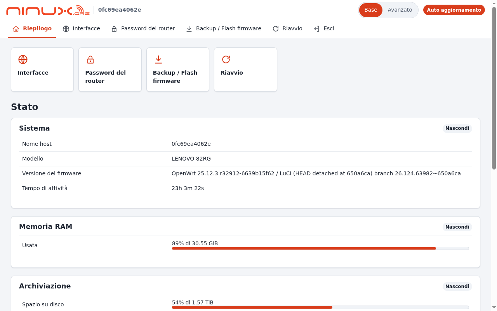
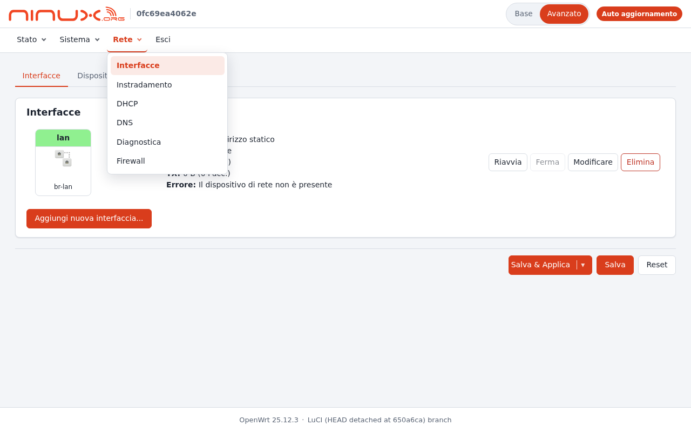
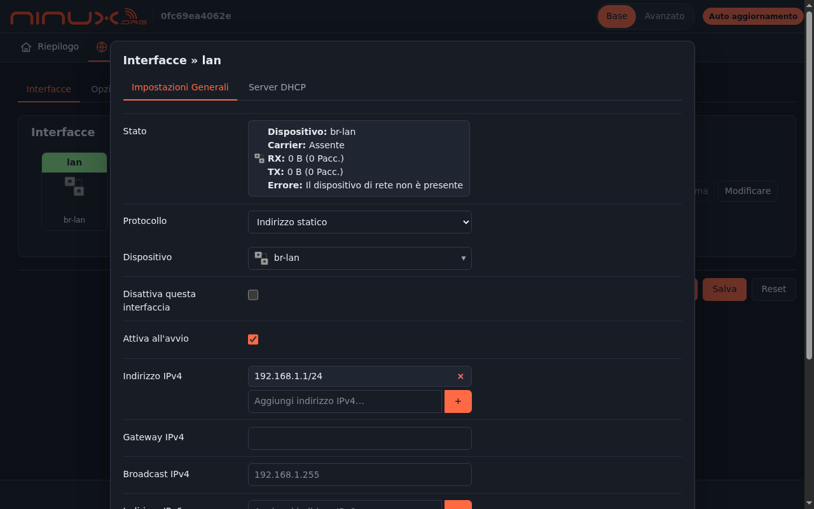
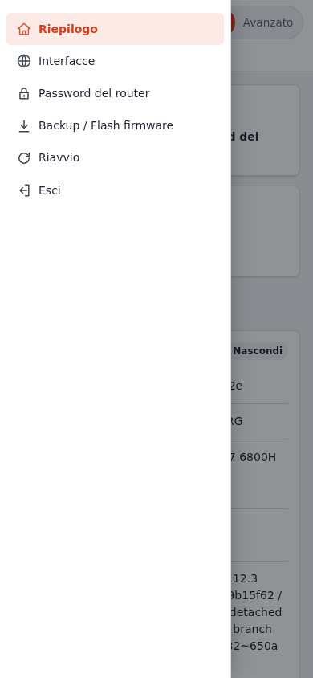
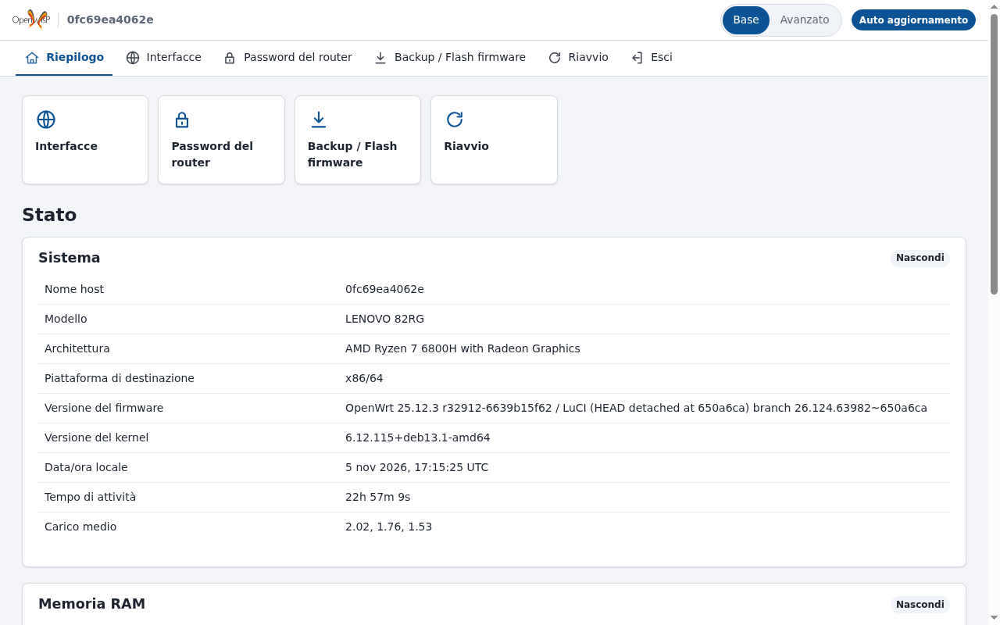

# luci-theme-ninux

[🇮🇹 Italiano](README.md) · 🇬🇧 English

[](https://github.com/mikysal78/luci-theme-ninux/actions/workflows/ci.yml) [](https://github.com/mikysal78/luci-theme-ninux/releases/latest)

> 📖 This repository is part of the **NINUX Basilicata** infrastructure: the step-by-step guide to rebuild all of it (Proxmox, DNS, OpenWISP, modules, firmware, app) is on **[GitHub Pages](https://mikysal78.github.io/ninux-basilicata-infra/en/)**.

A **lightweight** LuCI theme (OpenWrt 24.10 / 25.12), **simpler** than the
default one, with the menu on top (like Bootstrap) and a **Basic / Advanced**
switch in the header:

- **Basic**, for people who just use the router, a bit like commercial
  routers: a short menu with only the pages they need (overview, Wi-Fi,
  interfaces, password, backup/firmware, reboot), quick-link tiles on the
  overview and pages trimmed of expert options;
- **Advanced**, for whoever administers it: the full LuCI menu, with dropdown
  categories.

| Basic | Advanced |
|---|---|
|  |  |

| Dark theme (automatic) | Mobile | Replaced logo (OpenWISP) |
|---|---|---|
|  |  |  |

The screenshots show the Italian translation; without `luci-i18n-ninux-it` the
interface is in English.

## Why it is lightweight

Sizes of the installed files (OpenWrt 25.12.3 build, minified CSS and JS):

| | luci-theme-ninux | luci-theme-bootstrap |
|---|---|---|
| CSS | 33 KB, a single file | 51 KB, two files |
| Theme JavaScript | 9 KB (includes the Basic/Advanced logic) | 2 KB |
| Logo + favicon | 8 KB (SVG) | — |
| Total in `/www` | **51 KB** | 57 KB |
| `.apk` package | 18 KB | — |

The real gain is in the CSS (one file, a third smaller) and in the page, which
has fewer elements: system fonts, no libraries, no requests to the Internet.
Light or dark follows the operating system. The Ninux logo is the official one,
reduced from 63 KB to 7 KB (just the lettering, the waves and ".org").

## Basic and Advanced modes

The switch at the top right changes the menu on the fly (no reload) and the
choice is kept in the browser (`localStorage`). If a page that is not in the
Basic menu is opened in Basic mode (for example from a link), a notice appears
with a **Show the advanced menu** button.

The menu is a bar below the header: in Basic mode it shows items with an icon,
in Advanced mode the LuCI categories with a dropdown (it opens on click or on
mouse hover; Esc or a click outside closes it). Below 860 px it becomes a
slide-in panel, with the category of the current page already open.

In Basic mode some pages are also **trimmed**:

| Page | What is hidden |
|---|---|
| Status → Overview | *System* keeps hostname, model, firmware version and uptime; *Memory* and *Storage* keep one line, with just the usage percentage and the total size ("88% of 30.55 GiB"): buffers, cache, swap, temporary space and other mount points are hidden |
| Network → Interfaces | the *Devices* tab; the *Add new interface* and *Delete* buttons; of the *Global network options* only the IPv6 ULA prefix is left |
| Network → Wireless | the *Scan*, *Add* and *Remove* buttons; the edit dialog keeps *General Setup* and *Wireless Security* (*Advanced Settings*, *MAC-Filter*, *WLAN roaming* and "Allow legacy 802.11b rates" are hidden) |
| Network → Interfaces → Edit | *General Settings* and *DHCP Server* are left (*Advanced Settings*, *Physical Settings*, *Firewall Settings*, bridge ports and VLANs are hidden) |

Switching to Advanced shows everything again. The rules are at the end of
`cascade.css` ("Semplificazioni della modalità Base", Basic mode
simplifications) and, for the overview sections, in `BASIC_STATUS` in
`menu-ninux.js`.

> ⚠️ Basic mode is a **user interface simplification, not access control**:
> advanced pages stay reachable by URL. The real permissions are still LuCI's
> (users and rpcd ACLs).

The pages of the Basic menu are set in UCI. An item can be a page
(`admin/network/wireless`) or a single tab (`admin/system/admin/password`: of
the Administration page only the password tab is shown). Items that do not
exist on the router (e.g. Wi-Fi on a router without radios) are skipped.

## Configuration (`/etc/config/luci`, section `ninux`)

| Option | Default | Meaning |
|---|---|---|
| `default_mode` | `basic` | initial mode, `basic` or `advanced` |
| `allow_advanced` | `1` | `0` hides the switch and leaves the Basic menu only |
| `basic` (list) | see below | pages of the Basic menu, in order |
| `logo` | `/luci-static/ninux/logo.svg` | logo URL, as seen by the **browser**: path on the router, `https://…` or `data:` URI |
| `brand` | `ninux` | alt text of the logo |
| `accent` | Ninux orange `#d93d1c` | accent colour (`#rgb` or `#rrggbb`); hover and background shades are derived from it |
| `accent_dark` | `#ff6a45` | accent colour in the dark theme (falls back to `accent`) |

Default Basic menu:

```
admin/status/overview
admin/network/wireless
admin/network/network
admin/system/admin/password
admin/system/flash
admin/system/reboot
admin/logout
```

Example:

```sh
uci set luci.ninux.logo='https://openwisp.example.org/static/ui/openwisp/images/openwisp-logo-black.svg'
uci set luci.ninux.brand='OpenWISP'
uci set luci.ninux.accent='#0b5394'
uci delete luci.ninux.basic
uci add_list luci.ninux.basic='admin/status/overview'
uci add_list luci.ninux.basic='admin/network/wireless'
uci add_list luci.ninux.basic='admin/logout'
uci commit luci
```

An external logo (`https://…`) requires whoever opens LuCI to reach that
server; for an isolated router use a local path or a `data:` URI. The logo is
shown 28 pixels high and at most 220 wide (24 × 150 on phones).

### With OpenWISP

The `openwisp2` repository has the **Tema LuCI ninux** template
(`openwisp-templates/luci-theme-ninux.json`): it writes the `luci.ninux`
section from the variables `luci_logo`, `luci_brand`, `luci_accent`,
`luci_accent_dark`, `luci_mode` and `luci_allow_advanced`. The values for
everyone are in the global context of the playbook (`ninux_luci_*` variables);
for a single organization, the logo (with upload), name, colours and mode are
chosen with the [openwisp-luci-theme](https://github.com/mikysal78/openwisp-luci-theme)
module; for a single router, in the device variables.

## Install from the ready-made packages

Each version has its [Release](https://github.com/mikysal78/luci-theme-ninux/releases)
with the packages already built (architecture `all`, they fit every router):

```sh
# OpenWrt 25.12
apk add --allow-untrusted ./luci-theme-ninux-<version>-r1.apk
# OpenWrt 24.10
opkg install ./luci-theme-ninux_<version>-r1_all.ipk
```

The Italian translation is the `luci-i18n-ninux-it` package, in the same
Release.

## Build

CI (GitHub Actions) checks the code and builds the package with the OpenWrt
24.10 and 25.12 SDKs on every push; the packages can be downloaded from the
artifacts of the run. To publish a version, bump `PKG_VERSION` in the
`Makefile` and push to `main`: CI creates the `v<version>` tag and the Release
with the packages.

As a feed (recommended), in `feeds.conf`:

```
src-git ninux_theme https://github.com/mikysal78/luci-theme-ninux.git
```

```sh
./scripts/feeds update ninux_theme
./scripts/feeds install luci-theme-ninux
make menuconfig   # LuCI → Themes → luci-theme-ninux
make package/luci-theme-ninux/compile
```

or by copying (or linking) the `luci-theme-ninux/` folder into `package/`. The
Italian translation (`luci-i18n-ninux-it`) is built if Italian is enabled in
the firmware (`CONFIG_LUCI_LANG_it`).

The theme is added next to the default ones (Bootstrap stays installed). On
first install it becomes the default theme; it can be changed in *System →
System → Language and Style*. Uninstalling it, LuCI goes back to the first
remaining theme, usually Bootstrap.

The package depends on everything `luci-light` brings **except Bootstrap**
(`luci-mod-admin-full`, `luci-proto-ipv6`, `luci-app-firewall`,
`luci-proto-ppp`, `rpcd-mod-rrdns`, `uhttpd`, `uhttpd-mod-ubus`). On a router
with little flash you can therefore have the full LuCI without Bootstrap:
select `luci-theme-ninux` instead of `luci`/`luci-light` in `.config`, and
`luci-theme-bootstrap` stays out. For HTTPS and package management, what
`luci-ssl` would add: `libustream-mbedtls`, `px5g-mbedtls` and
`luci-app-package-manager`.

## Technical notes

- ucode templates (`ucode/template/themes/ninux/`) and the menu in JavaScript
  (`menu-ninux.js`), like the official themes of modern LuCI.
- Tested with OpenWrt 25.12.3 (LuCI 26.124) in a container: login, overview,
  interfaces with modal dialog and dropdowns, firewall, dark theme, widths
  1280/1024/390 px without horizontal scrolling.
- The `RPCError: … uci/get … Access denied` error in the console of the login
  page does not come from the theme: it is a bug of `form.js` in LuCI 25.12
  (fixed in master with commit `a818ac89bb0e`). The NINUX build fixes it with a
  patch.
- No `@container` in the CSS: the minifier of the LuCI build (`csstidy`) does
  not know them and would move their rules out.

## License

Apache-2.0, like LuCI. The template structure and some widget rules are
derived from `luci-theme-bootstrap` (The LuCI Team). The Ninux logo belongs to
the Ninux community.
