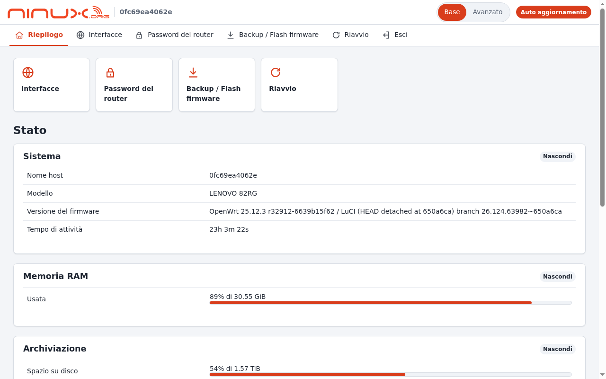
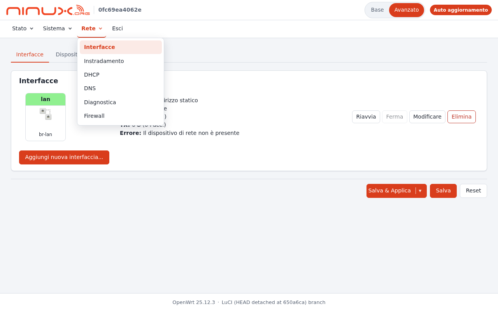
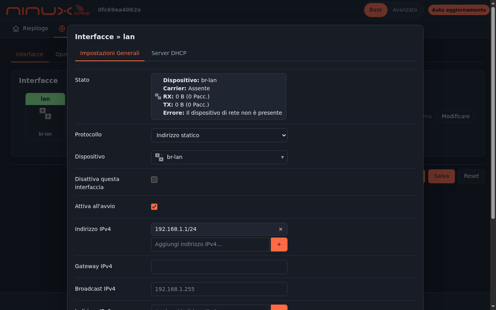
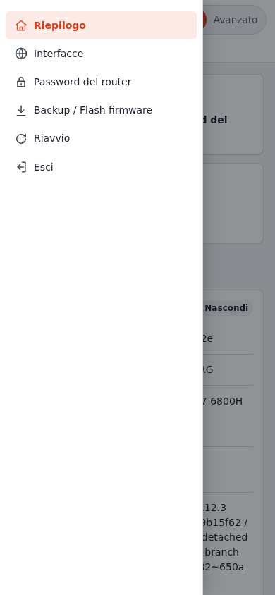
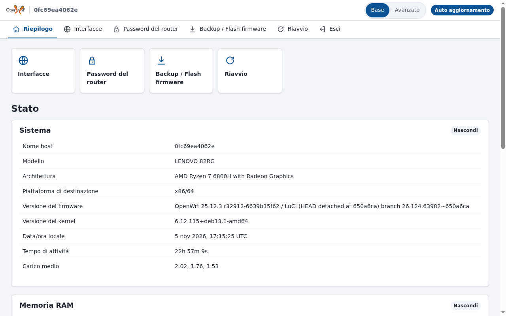

# luci-theme-ninux

🇮🇹 Italiano · [🇬🇧 English](README.en.md)

[](https://github.com/mikysal78/luci-theme-ninux/actions/workflows/ci.yml) [](https://github.com/mikysal78/luci-theme-ninux/releases/latest)

> 📖 Questo repository fa parte dell'infrastruttura di **NINUX Basilicata**: la guida per ricostruirla tutta, passo passo (Proxmox, DNS, OpenWISP, moduli, firmware, app), è su **[GitHub Pages](https://mikysal78.github.io/ninux-basilicata-infra/)**.

Un tema per LuCI (OpenWrt 24.10 / 25.12) **leggero** e **più semplice** di
quello predefinito, con il menu in alto (come Bootstrap) e un interruttore
**Base / Avanzato** nell'header:

- **Base**, per chi usa il router e basta, un po' come nei router commerciali:
  un menu corto con le sole pagine che servono (panoramica, Wi-Fi, interfacce,
  password, backup/firmware, riavvio), riquadri rapidi nella panoramica e
  pagine sfoltite dalle opzioni da esperti;
- **Avanzato**, per chi lo amministra: il menu completo di LuCI, con le
  categorie a tendina.

| Base | Avanzato |
|---|---|
|  |  |

| Tema scuro (automatico) | Mobile | Logo sostituito (OpenWISP) |
|---|---|---|
|  |  |  |

## Perché è leggero

Misure sui file installati (build OpenWrt 25.12.3, CSS e JS minificati):

| | luci-theme-ninux | luci-theme-bootstrap |
|---|---|---|
| CSS | 33 KB, un solo file | 51 KB, due file |
| JavaScript del tema | 9 KB (c'è la logica Base/Avanzato) | 2 KB |
| Logo + favicon | 8 KB (SVG) | — |
| Totale in `/www` | **51 KB** | 57 KB |
| Pacchetto `.apk` | 18 KB | — |

Il guadagno vero è nel CSS (un file solo, un terzo in meno) e nella pagina, che
ha meno elementi: font di sistema, nessuna libreria, nessuna richiesta verso
Internet. Chiaro o scuro segue il sistema operativo. Il logo Ninux è quello
ufficiale ridotto da 63 KB a 7 KB (solo scritta, onde e «.org»).

## Modalità Base e Avanzato

L'interruttore in alto a destra cambia il menu al volo (senza ricaricare) e la
scelta resta nel browser (`localStorage`). Se in modalità Base si apre una
pagina che non è nel menu Base (per esempio da un link), compare un avviso con
il pulsante **Mostra il menu avanzato**.

Il menu sta in una barra sotto l'header: in Base sono voci con l'icona, in
Avanzato le categorie di LuCI con la tendina (si apre al clic o al passaggio
del mouse; Esc o un clic fuori la chiudono). Sotto gli 860 px diventa un
pannello a scomparsa, con la categoria della pagina corrente già aperta.

In modalità Base alcune pagine sono anche **sfoltite**:

| Pagina | Cosa si nasconde |
|---|---|
| Stato → Panoramica | in *Sistema* restano nome host, modello, versione del firmware e tempo di attività; in *Memoria RAM* e *Archiviazione* resta una riga, con la sola percentuale d'uso e la dimensione massima («88% di 30.55 GiB»): via buffer, cache, swap, spazio temporaneo e altri punti di mount |
| Rete → Interfacce | la scheda *Dispositivi*; i pulsanti *Aggiungi nuova interfaccia* ed *Elimina*; delle *Opzioni di rete globali* resta solo il prefisso IPv6 ULA |
| Rete → Wi-Fi | i pulsanti *Scan*, *Add* e *Remove*; nella finestra di modifica restano *Impostazioni generali* e *Sicurezza wireless* (via *Avanzate*, *Filtro MAC*, *Roaming* e «Allow legacy 802.11b rates») |
| Rete → Interfacce → Modifica | restano *Impostazioni generali* e *Server DHCP* (via *Avanzate*, *Fisiche*, *Firewall*, porte e VLAN del bridge) |

Passando ad Avanzato tutto torna visibile. Le regole stanno in fondo a
`cascade.css` («Semplificazioni della modalità Base») e, per le sezioni della
panoramica, in `BASIC_STATUS` di `menu-ninux.js`.

> ⚠️ La modalità Base è una **semplificazione dell'interfaccia, non un
> controllo di accesso**: le pagine avanzate restano raggiungibili dall'URL. I
> permessi veri restano quelli di LuCI (utenti e ACL di rpcd).

Le pagine del menu Base si scelgono in UCI. Una voce può essere una pagina
(`admin/network/wireless`) o una singola scheda (`admin/system/admin/password`:
della pagina Amministrazione si vede solo la scheda della password). Le voci che
sul router non esistono (es. Wi-Fi su un router senza radio) vengono saltate.

## Configurazione (`/etc/config/luci`, sezione `ninux`)

| Opzione | Default | Significato |
|---|---|---|
| `default_mode` | `basic` | modalità iniziale, `basic` o `advanced` |
| `allow_advanced` | `1` | `0` nasconde l'interruttore e lascia solo il menu Base |
| `basic` (lista) | vedi sotto | pagine del menu Base, in ordine |
| `logo` | `/luci-static/ninux/logo.svg` | URL del logo, visto dal **browser**: percorso sul router, `https://…` o `data:` URI |
| `brand` | `ninux` | testo alternativo del logo |
| `accent` | arancione Ninux `#d93d1c` | colore d'accento (`#rgb` o `#rrggbb`); hover e sfondi si ricavano da soli |
| `accent_dark` | `#ff6a45` | colore d'accento nel tema scuro (se manca si usa `accent`) |

Menu Base predefinito:

```
admin/status/overview
admin/network/wireless
admin/network/network
admin/system/admin/password
admin/system/flash
admin/system/reboot
admin/logout
```

Esempio:

```sh
uci set luci.ninux.logo='https://openwisp.example.org/static/ui/openwisp/images/openwisp-logo-black.svg'
uci set luci.ninux.brand='OpenWISP'
uci set luci.ninux.accent='#0b5394'
uci delete luci.ninux.basic
uci add_list luci.ninux.basic='admin/status/overview'
uci add_list luci.ninux.basic='admin/network/wireless'
uci add_list luci.ninux.basic='admin/logout'
uci commit luci
```

Un logo esterno (`https://…`) richiede che chi apre LuCI raggiunga quel server;
per un router isolato conviene un percorso locale o un `data:` URI. Il logo si
vede alto 28 pixel e largo al massimo 220 (24 × 150 sul telefono).

### Con OpenWISP

Nel repo `openwisp2` c'è il template **Tema LuCI ninux**
(`openwisp-templates/luci-theme-ninux.json`): scrive la sezione `luci.ninux`
con le variabili `luci_logo`, `luci_brand`, `luci_accent`, `luci_accent_dark`,
`luci_mode` e `luci_allow_advanced`. I valori per tutti stanno nel contesto
globale del playbook (variabili `ninux_luci_*`); per una singola
organizzazione si scelgono logo (con l'upload), nome, colori e modalità con il
modulo [openwisp-luci-theme](https://github.com/mikysal78/openwisp-luci-theme);
per un solo router, nelle variabili del device.

## Installazione dai pacchetti pronti

Ogni versione ha la sua [Release](https://github.com/mikysal78/luci-theme-ninux/releases)
con i pacchetti già compilati (architettura `all`, vanno bene per ogni router):

```sh
# OpenWrt 25.12
apk add --allow-untrusted ./luci-theme-ninux-<versione>-r1.apk
# OpenWrt 24.10
opkg install ./luci-theme-ninux_<versione>-r1_all.ipk
```

La traduzione italiana è il pacchetto `luci-i18n-ninux-it`, nella stessa Release.

## Compilazione

La CI (GitHub Actions) controlla il codice e compila il pacchetto con l'SDK di
OpenWrt 24.10 e 25.12 a ogni push; i pacchetti restano scaricabili tra gli
artifact dell'esecuzione. Per pubblicare una versione basta alzare
`PKG_VERSION` nel `Makefile` e fare push su `main`: la CI crea il tag
`v<versione>` e la Release con i pacchetti.

Come feed (consigliato), in `feeds.conf`:

```
src-git ninux_theme https://github.com/mikysal78/luci-theme-ninux.git
```

```sh
./scripts/feeds update ninux_theme
./scripts/feeds install luci-theme-ninux
make menuconfig   # LuCI → Themes → luci-theme-ninux
make package/luci-theme-ninux/compile
```

oppure copiando (o collegando) la cartella `luci-theme-ninux/` in `package/`.
La traduzione italiana (`luci-i18n-ninux-it`) si compila se nel firmware è
attivo l'italiano (`CONFIG_LUCI_LANG_it`).

Il tema si aggiunge a quelli già presenti (Bootstrap resta installato). Alla
prima installazione diventa quello predefinito; si cambia da
*Sistema → Sistema → Lingua e stile*. Disinstallandolo LuCI torna al primo
tema rimasto, di solito Bootstrap.

Il pacchetto dipende da tutto quello che porta `luci-light` **tranne
Bootstrap** (`luci-mod-admin-full`, `luci-proto-ipv6`, `luci-app-firewall`,
`luci-proto-ppp`, `rpcd-mod-rrdns`, `uhttpd`, `uhttpd-mod-ubus`). Su un router
con poca flash si può quindi avere LuCI completa senza Bootstrap: nel `.config`
si seleziona `luci-theme-ninux` al posto di `luci`/`luci-light`, e
`luci-theme-bootstrap` resta fuori. Per HTTPS e gestione pacchetti, quello che
aggiungerebbe `luci-ssl`: `libustream-mbedtls`, `px5g-mbedtls` e
`luci-app-package-manager`.

## Note tecniche

- Template ucode (`ucode/template/themes/ninux/`) e menu in JavaScript
  (`menu-ninux.js`), come i temi ufficiali di LuCI moderno.
- Provato con OpenWrt 25.12.3 (LuCI 26.124) in un container: login, panoramica,
  interfacce con finestra modale e dropdown, firewall, tema scuro, larghezze
  1280/1024/390 px senza scorrimento orizzontale.
- L'errore `RPCError: … uci/get … Access denied` nella console della pagina di
  login non viene dal tema: è un bug di `form.js` in LuCI 25.12 (corretto in
  master con il commit `a818ac89bb0e`). La build NINUX lo corregge con una patch.
- Niente `@container` nel CSS: il minificatore della build LuCI (`csstidy`) non
  le conosce e ne sposterebbe le regole fuori.

## Licenza

Apache-2.0, come LuCI. La struttura dei template e alcune regole dei widget
derivano da `luci-theme-bootstrap` (The LuCI Team). Il logo Ninux è della
comunità Ninux.
